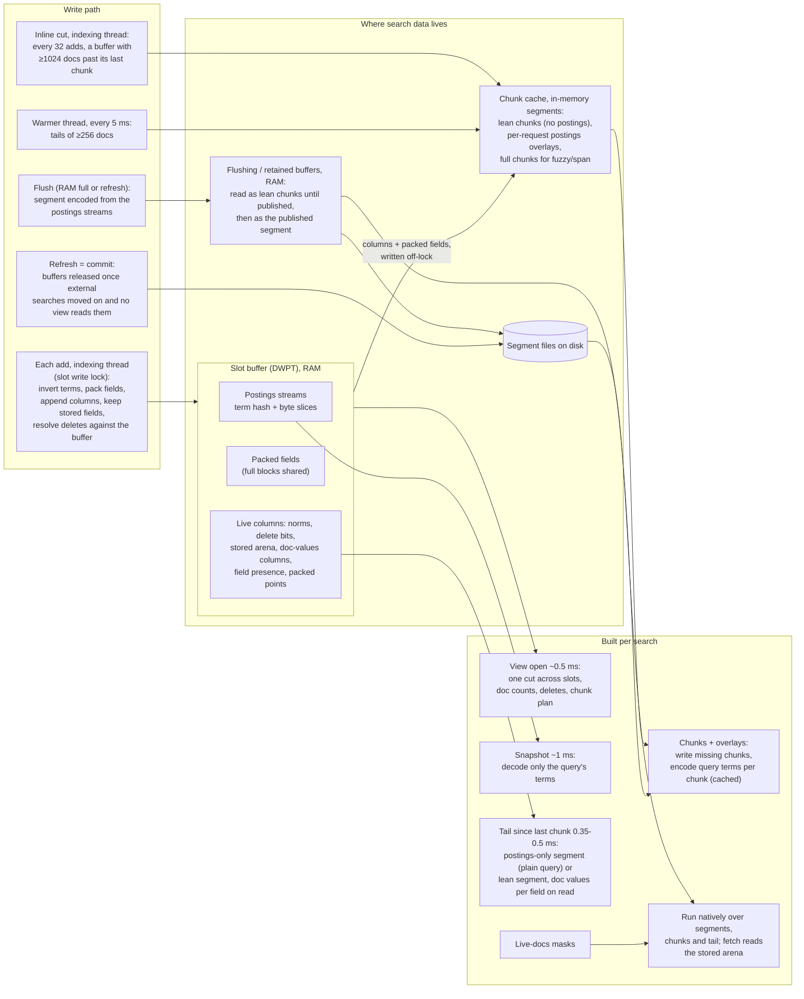

# Realtime search: where the data comes from

With `index.lucene_rust.realtime_search` on, a search reads the writer's
indexing buffers next to the refreshed segments, so a document is searchable
right after its ack, without a refresh. This page shows where each piece of
search data lives, which thread builds it as documents arrive, and what a
search still builds before its query runs.

Code: `crates/lucene-index/src/concurrent_writer/live.rs` (buffers, views,
chunk writes), `concurrent_writer/live/{doc_values,chunk_fields}.rs`
(columns), `index_writer/pending_postings/live.rs` (reading buffered
postings), `crates/lucene-search/src/live_segment.rs` (per-search postings
segments) and `crates/lucene-ffi/src/live.rs` (chunk cache, warmer, the
plugin entry points).

## Where each piece is built

| Data | Built by | When | Read by a search as |
|---|---|---|---|
| Segment files | flush | RAM buffer full, or refresh (a commit under realtime) | the commit's reader; deletes since the commit applied as masks |
| Postings streams (term hash + byte slices) | indexing thread | every add | the snapshot decodes the query's terms only |
| Packed fields | indexing thread | every add | source for chunk writes (full blocks shared, not copied) |
| Live columns (norms, deletes, stored arena, doc values, presence, points) | indexing thread | every add | chunk and tail writes; fetch reads the stored arena |
| Lean chunks (norms, doc values, points, stored; no postings) | indexing thread (inline cut), warmer thread, or a search | inline every 1024 docs; warmer every 5 ms for tails of at least 256 docs | cached segments, with the query's terms overlaid |
| Postings overlays | the first search with that request | per chunk, up to 8 kept | reused by later searches with the same request |
| Tail segment | each search | always, for the docs after the last chunk | a postings-only segment (plain query) or a lean segment with doc values encoded per field on first read and points only when queried |
| Full chunks with postings | a search that needs them | fuzzy, span, uncompiled regexp | slow path |

A new chunk absorbs the one before it when that one is no bigger, so a
buffer holds about log2(docs / chunk) chunks and each document is written a
few times. A search absorbs at most 4096 docs itself; larger rewrites are
left to the warmer. A buffer taken for a flush stays readable as lean chunks
until it is published and no view reads it that way, then as its published
segment (files pinned against merges) until the commit holding it is
released.

## Measured search-side costs

1M-doc bench, indexing and closed-loop searchers together on a saturated
4-core box:

| Phase | Under load | Note |
|---|---|---|
| View open | ~0.5 ms | 0.03 ms of it is CPU; the rest is waiting |
| Snapshot of query terms | ~1 ms | time under slot locks, not decoding |
| Chunk writes | ~1.4 ms | mostly inline cuts on indexing threads |
| Lean view reader (sort/agg) | ~2.9 ms | chunks + snapshot + overlays + tail + append |
| Lean tail write | ~0.35 ms | idle: ~0.5 ms of a 0.9 ms term search |

## Not built yet

- Sealed 256-doc postings blocks in the buffer, in Lucene's `.doc` block
  format, so the snapshot reads them in place (idle micro: 113 to 41 us).
- A flush that reuses those blocks or the chunks; today the flush encodes the
  segment again from the postings streams.
