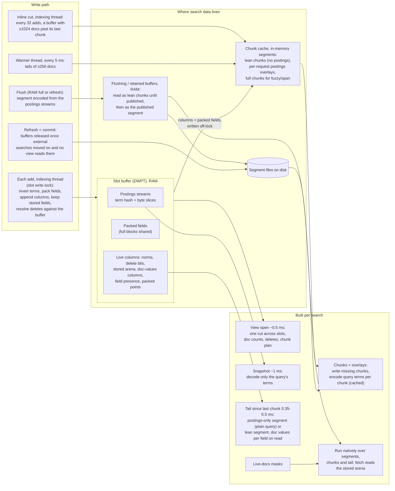

# Realtime search: where the data comes from

With `index.lucene_rust.realtime_search` on, a search reads the writer's
indexing buffers next to the refreshed segments, so a document is searchable
right after its ack, without a refresh. This page shows where each piece of
search data lives, which thread builds it as documents arrive, and what a
search still builds before its query runs.

Code: `crates/lucene-index/src/concurrent_writer/live.rs` (buffers, views,
chunk writes), `concurrent_writer/live/{doc_values,chunk_fields}.rs`
(columns), `index_writer/pending_postings/live.rs` (reading buffered
postings), `crates/lucene-search/src/live_segment.rs` (per-search postings
segments) and `crates/lucene-ffi/src/live.rs` (chunk cache, warmer, the
plugin entry points).

## Where each piece is built

| Data | Built by | When | Read by a search as |
|---|---|---|---|
| Segment files | flush | RAM buffer full, or refresh (a commit under realtime) | the commit's reader; deletes since the commit applied as masks |
| Postings streams (term hash + byte slices) | indexing thread | every add | the snapshot decodes the query's terms only |
| Packed fields | indexing thread | every add | source for chunk writes (full blocks shared, not copied) |
| Live columns (norms, deletes, stored arena, doc values, presence, points) | indexing thread | every add | chunk and tail writes; fetch reads the stored arena |
| Lean chunks (norms, doc values, points, stored; no postings) | indexing thread (inline cut), warmer thread, or a search | inline every 1024 docs; warmer every 5 ms for tails of at least 256 docs | cached segments, with the query's terms overlaid |
| Postings overlays | the first search with that request | per chunk, up to 8 kept | reused by later searches with the same request |
| Tail segment | each search | always, for the docs after the last chunk | a postings-only segment (plain query) or a lean segment with doc values encoded per field on first read and points only when queried |
| Full chunks with postings | a search that needs them | fuzzy, span, uncompiled regexp | slow path |

A new chunk absorbs the one before it when that one is no bigger, so a
buffer holds about log2(docs / chunk) chunks and each document is written a
few times. A search absorbs at most 4096 docs itself; larger rewrites are
left to the warmer. A buffer taken for a flush stays readable as lean chunks
until it is published and no view reads it that way, then as its published
segment (files pinned against merges) until the commit holding it is
released.

On the Java side, a search over the buffers reads a new reader, so anything
OpenSearch caches per reader (global ordinals, for one) is built again for it.
The plugin's aggregation processor therefore builds the aggregators of a
search over the buffers only when their collector is first asked for; a
natively answered `terms` aggregation never builds the global ordinals
OpenSearch's aggregator would (about 1 ms per search at 1M).

## Vector fields

A k-NN query on a realtime index runs natively over the view
(`ffi_live_view_knn`; `KnnEncoder.topHits` routes a live reader there):
committed segments search their graphs or IVF lists as usual, and each leaf of
buffered documents is scanned exactly, so its scores are exact and merge
directly with the committed ones. A filter overlays only its own terms on the
lean chunks, and the deletes since the commit mask both. A nested k-NN query
reads the view's reader of every term.

A field whose format has an HNSW graph keeps one over each buffer's vectors
as they arrive (`lucene_codecs::buffer_vectors::BufferGraph`). The indexing
thread only appends the vector (shared with the document, not copied); one
background inserter per buffer and field adds the appended ordinals to the
graph in order, so the graph is exactly the one the flush's
`HnswGraphBuilder` builds over the same vectors, seed and parameters. The
flush writes that graph instead of building it, and the segment is byte for
byte the one written with realtime off. A search of the view walks the graph
over the vectors the inserter finished (per-node locks, the published prefix
only) and scores the rest exactly; a buffer smaller than about 400k vector
components (4k 100-d vectors), or a filter that leaves fewer documents than
the walk would visit, is scanned exactly. Fields with an IVF format, a
Hamming byte format or an index sort keep no graph and are scanned exactly.

Why per-node locks (`crates/lucene-search/examples/realtime_knn_concurrent.rs`,
search p50/p99 in us while one inserter runs, 1 searcher unless noted):

| Data, buffer, insert rate | no inserts | one lock around the graph | per-node locks |
|---|---|---|---|
| GloVe 100-d, 50k, 2k/s | 105 / 177 | 112 / 809 | 110 / 216 |
| GloVe 100-d, 100k, 5k/s, 3 searchers | 139 / 268 | 721 / 2542 (inserter fell to 2.3k/s) | 129 / 245 |
| fastText 300-d, 60k, 2k/s | 170 / 290 | 213 / 1743 | 163 / 268 |

Run with `cargo run --release -p lucene-search --example
realtime_knn_concurrent -- /tmp/data/glove100 --buffer 50000 --rate 2000
--searchers 2 --seconds 10` (the example's doc lists its modes and data). For comparison, scanning 100k buffered
GloVe vectors exactly took 1480 us.

End to end (`lucene-ffi` `live_knn_tail_timing`, release, 128-d random
vectors, 20k committed and 100k buffered, k 10 over 100 candidates): a k-NN
search of the view takes 521 us p50 (796 us with the view's first reader
build), against 414 us once the same documents are flushed. The flush and
commit of the 100k buffered vectors takes 1.3 s, as the graph is already
built. A burst of adds outruns the inserter (about 3k 128-d vectors a second
with M 16 and beam 100): the vectors it has not reached are scanned exactly
until it catches up.

Memory. There is no queue of pending vectors: the inserter's backlog is the
buffer's own vectors, shared with the documents, so a burst that outruns it
costs exact scoring of the tail, not memory. The buffer flushes at the RAM
buffer's limit as with realtime off, which bounds both the backlog and the
graph; the graph itself (about 0.4 KB a vector at M 16, reported by
`live_bytes` while the buffer is in its slot) is not charged to the RAM buffer, so segments end at the same
documents. A buffer's graph goes with its flush: views of a flushing or
published buffer read its vectors from the segment, and an inserter
still running stops once the flush is done with the graph. Peak RSS of a burst
(`lucene-index` example `live_vector_memory`, 4 indexing threads on 4 cores,
64 MB RAM buffer, a view opened every 100 ms, no commit until the end):

| Burst | realtime off | realtime on |
|---|---|---|
| 300k x 128-d (146 MiB of vectors) | 446 MiB | 497-501 MiB |
| 80k x 768-d (234 MiB of vectors) | 416 MiB | 422-467 MiB |

Chunks and tails with vectors write them flat, with no HNSW graph and no IVF
lists (`.vem` records no graph levels, the layout of a stock segment too small
for a graph, which Java's `Lucene99HnswVectorsReader` and the plugin's IVF
format also read exactly); a k-NN search of a buffer with a graph reads only
their deletes and filter matches. Chunks and tails with vectors are still
written as segments, not lean parts: about 1.3 ms per view for a tail of about
2.5k 128-d vectors.

## Searches Lucene answers

To Lucene a leaf of buffered documents holds no terms or values and every
document in it is deleted, so a search the native engine cannot run (a
`script` query, highlighting, `version`, `seq_no_primary_term`, `explain`,
inner hits, nested fields, a scoring multi-term rewrite) would miss them.
Before Lucene runs one, the view is handed to it once
(`ffi_live_view_lucene`, `LiveDirectoryReader.readByLucene`):

- each leaf of buffered documents gets a segment of them with postings: the
  view's full chunk (written as a search needing postings writes it, kept in
  memory and copied to a Java `ByteBuffersDirectory`), or, for a buffer
  flushed since the view opened, its published segment (waited for up to 30 s;
  the leaf's part copied out with `IndexWriter.addIndexes` when the segment
  holds more documents than the view saw). The view's deletes are its live
  documents; stored fields stay read through the view;
- the commit's leaves leave out the documents deleted since the commit (an
  update's old version), as the native search's masks do;
- the reader takes a new cache key, the aggregators built so far are built
  again, and the query is rewritten again, so nothing read before counts.

The cost is a chunk write with postings and a copy per leaf, once per view;
natively answered searches pay nothing.

## Measured search-side costs

1M-doc bench, indexing and closed-loop searchers together on a saturated
4-core box:

| Phase | Under load | Note |
|---|---|---|
| View open | ~0.5 ms | 0.03 ms of it is CPU; the rest is waiting |
| Snapshot of query terms | ~1 ms | time under slot locks, not decoding |
| Chunk writes | ~1.4 ms | mostly inline cuts on indexing threads |
| Lean view reader (sort/agg) | ~2.9 ms | chunks + snapshot + overlays + tail + append |
| Lean tail write | ~0.35 ms | idle: ~0.5 ms of a 0.9 ms term search |

## Not built yet

- Sealed 256-doc postings blocks in the buffer, in Lucene's `.doc` block
  format, so the snapshot reads them in place (idle micro: 113 to 41 us).
- A flush that reuses those blocks or the chunks; today the flush encodes the
  segment again from the postings streams.
