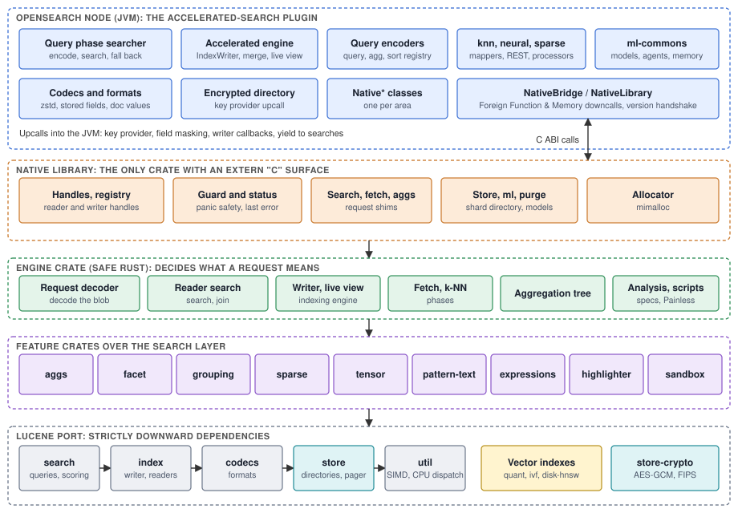
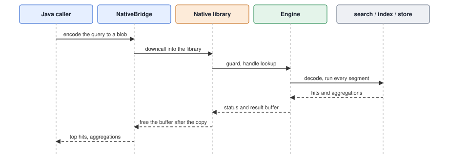

# Architecture

The plugin is a Java OpenSearch plugin in front of one native library. Java decides *whether* a
request can run natively and encodes it; the library decides what it means and runs it; anything
the library cannot do goes back to OpenSearch unchanged.

Top to bottom is both call direction and dependency direction: a layer only knows the ones below it.

## The layers

**Java plugin** (`opensearch-plugin/`). Hooks OpenSearch's extension points: the query phase
searcher, the engine factory, the store and codec registries, and the mappers and REST handlers of
k-NN, neural search, sparse search and ml-commons. Each query, aggregation and sort has an encoder;
a request that has no encoder, or that fails a static check, falls back, and the reason is counted.

**Native library** (`crates/lucene-ffi`). The only crate with a C ABI and `unsafe` boundary code:
handles, a registry, panic safety (a panic never crosses into the JVM), and a thread-local last
error. Every call checks the library's ABI version at node startup.

**Engine** (`crates/lucene-engine`). Safe Rust. Decodes a request blob, runs it across segments,
drives the indexing writer, and assembles hits, aggregations and fetch results.

**Feature crates.** Aggregations, facets, grouping, highlighting, sparse (Seismic) and
multi-vector search, pattern-text, expressions and Painless, built over the search layer.

**Lucene port.** `util`, `store`, `codecs`, `index`, `search`, ported by on-disk format so that the
files are the ones Lucene reads and writes. Dependencies only point downward, checked by the build.

## One search call

Results come back in buffers the library allocated; Java copies them and returns the buffer.
A failing call returns a status and leaves its message in the thread's last-error slot. Writes follow
the same path through the writer functions, with upcalls to Java for keys and callbacks.

## Storage

- **Local disk**: memory-mapped files with access-pattern advice, or a demand **pager** that replaces
  the kernel's page cache so all index memory sits under one explicit budget.
- **Object stores**: a generic ranged-read interface (no store-specific code in the index
  layer) behind the same page cache, with an optional NVMe tier.
- **Encryption** wraps whichever directory is chosen: per-file AES-256-GCM, keys held in the JVM,
  with a FIPS 140-3 build of the native library.

See [Storage and encryption](reference/pluggable-storage.md).

## Vectors, sparse and ML

One vector stack serves every k-NN field, selected per field by the method in the mapping: HNSW
(the default), quantized HNSW and IVF (RaBitQ, OSQ), and opt-in disk HNSW. Sparse retrieval
(Seismic) and multi-vector (`max_sim`) sit above the search layer. Local ML models run in process
through ONNX Runtime or libtorch; remote connectors, agents and memory are in the Java ml package.

## Verification

Correctness rests on differential tests against real Lucene: Java programs write fixtures that the
Rust readers must decode, and Java programs open what Rust wrote. End to end, a real OpenSearch node
answers the same requests with and without the plugin and the responses are compared, and
OpenSearch's own engine tests and REST YAML suites run on the accelerated engine.
See [Contributing](contributing.md).
